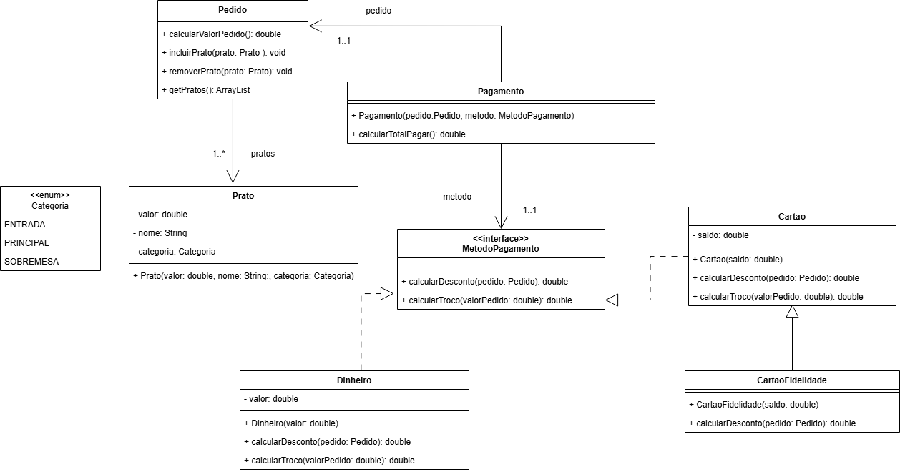

# Exercício: Restaurante Polimórfico

## 🎯 Objetivo
Implemente um sistema de gestão de pedidos de um restaurante. O sistema deve ser capaz de gerenciar pratos, calcular totais e aplicar diferentes regras de desconto baseadas no método de pagamento.

## 🏗️ Estrutura do Projeto

### 1. Diagrama de classe

&&&Implemente o diagrama de classes abaixo seguindo o encapsulamento, bem como os relacionamentos entre as classes. Os métodos _getters_ e _setters_ foram ocultos mas **devem ser implementados** &&&

### &&&2. 🛠️ Regras de Negócio e Requisitos&&&

1. &&&**Cálculos de Valores:**&&&
* &&&**Pedido:** O método `calcularValorPedido` deve retornar a soma dos valores de todos os pratos, sem considerar descontos.&&&

* &&&**Pagamento:** O método `calcularTotalPagar` deve retornar o valor final já com o desconto do método de pagamento aplicado.&&&

* &&&**MetodoPagamento:** O método `calcularDesconto` deve retornar o valor que deve ser descontado do valor do pedido&&&

2. &&&**Lógica de Descontos por Método de Pagamento:**&&&

* &&&**Dinheiro:** 10% de desconto sobre o valor total.&&&

* &&&**Cartão de Crédito:** 5% de desconto sobre o valor total.&&&

* &&&**Cartão Fidelidade:** O cliente não paga a **sobremesa** (desconto de 100% nos itens da  categoria `SOBREMESA`). Caso o cliente **não** tenha consumido nenhuma sobremesa, 
o desconto aplicado será de **30%** sobre o valor total do pedido.&&&

3. &&&**Cálculo de Troco:**&&&
* &&&**Dinheiro:** O sistema deve calcular o troco a ser devolvido.&&&

* &&&**Cartão:** O troco deve ser sempre **R$0,00**.&&&

4. &&&**Validações e Exceções:**&&&
* &&&**Campos Obrigatórios:** Os valores numéricos não podem ser menores ou iguais a zero.&&&

* &&&**Referências:** Referências de objetos não podem ser nulas (`null`).&&&

* &&&**Enumeração:** Caso o atributo **categoria** na classe **Prato** for nula lance uma exceção `CategoriaInvalidaException`, esta classe de exceção deve ser crida a partir da herança da classe `IllegalArgumentException`&&& 

* &&&**Mensagens de Erro:** Caso uma validação falhe, lance uma exceção `IllegalArgumentException` com a 
mensagem: `"NOME_DO_ATRIBUTO invalido"` 
(ex: `"Categoria invalido"`).&&&